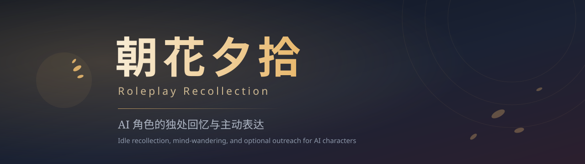

> Unreleased source additions: read-only JSON/JSONL/SQLite adapters, validated setup mapping and global RP runtime. Requires Node >=22.16. See [integration guide](docs/read-only-sources.md). Public v0.3.0 assets do not contain these changes.

<p align="center">
  
</p>

# AI Roleplay Recollection

A modular recollection engine for AI roleplay and conversational companion agents. Stores discrete source-backed episodes, applies time-based detail degradation, and provides cue recall with controlled, low-frequency wandering.

The core manages state and generates candidates; conversation orchestration, model execution, and message delivery remain the responsibility of the host application.

[中文](README.md) · [API](docs/api.md) · [Architecture](docs/architecture.md) · [DSH Bundle](dsh/README.md) · [Changelog](CHANGELOG.md)

[](https://github.com/BCOIgv/roleplay-recollection/actions/workflows/ci.yml)
[](https://nodejs.org/)
[](LICENSE)

---

## Core Mechanisms

- **Source-Backed Episodes**  
  Captures discrete interaction fragments (timestamp, summary gist, 1–3 raw excerpts, tags, and truth labels: `observed / reported / fictional`). Deduplication relies on full-evidence group hashing; supports revisions and withdrawals.
- **Progressive Detail Degradation**  
  Ordinary episodes fade over time unless explicitly retained: detailed quotes degrade into summary impressions, eventually becoming dormant from daily recall. Original excerpts remain in local storage, but the view layer stops exposing verbatim text to the model.
- **Zero-Extra-Call Retrieval**  
  Routine dialogue turns query `visible()` with lexical and tag filtering, adding no model calls.
- **Controlled Wandering (Solitude)**  
  When quiet conditions are satisfied (72–120 h intervals, minimum inactivity threshold, active time window), the agent enters a low-step recollection walk. Leaving quietly is valid; if a contact candidate is produced, cooldown is settled only after the host returns an actual delivery receipt.

---

## Scope and Boundaries

| Dimension | Specification |
| --- | --- |
| **Scheduling** | No background daemon or internal timers; execution timing is fully host-driven |
| **Model Access** | Host injects `reflect` / `wander` runners; core holds no vendor SDKs or API keys |
| **Message Delivery** | Core outputs candidates only (`sent: false`); host handles platform transmission |
| **Data Isolation** | Instance-level isolation; characters, scopes, and stories must use distinct instances and state directories |

---

## Installation & Quick Start

Requires Node.js ≥ 22, pure ESM, no runtime dependencies. Version `0.3.0` is a developer preview.

As of 2026-11-04, both packages are available through [GitHub Release v0.3.0](https://github.com/BCOIgv/roleplay-recollection/releases/tag/v0.3.0), but neither is available in the public npm registry. Install the core from the release:

```bash
npm install https://github.com/BCOIgv/roleplay-recollection/releases/download/v0.3.0/roleplay-recollection-0.3.0.tgz
```

```js
import { CompanionMemory } from 'roleplay-recollection';

const memory = new CompanionMemory({
  characterId: 'character_a',
  scopeId: 'private:user_01',
  mode: 'companion',
  stateDir: './data/memory_a', // omitted for in-memory only
});

// Capture an episode
memory.capture({
  id: 'ev-20261104-01',
  truth: 'observed',
  occurredAt: Date.now() - 3600000,
  gist: 'Read documents together during rain and spoke briefly',
  tags: ['rain', 'reading'],
  evidence: [{ id: 'msg-1', kind: 'shared_event', text: 'Rain intensified outside while looking through old books.' }],
}, { mode: 'companion' });

// Query visible memories (zero extra model calls)
const context = memory.visible({
  mode: 'companion',
  trigger: 'cue',
  cue: 'books',
});

await memory.close();
```

---

## API Summary

| API | Behavior | Extra model calls |
| --- | --- | --- |
| `capture` / `revise` / `forget` | Store, correct, or withdraw episodes | 0 |
| `visible` / `privateThoughts` | Supply material for an existing reply | 0 |
| `recollect({trigger:'cue'})` | Cue lookup, optional reflection | 0 or 1 |
| `solitude` / idle recollection | Wander when due and quiet; leaving is valid | Up to 2 by default |
| `takeExpression` / `settleExpression` | Take candidates and reconcile solitude contact | 0 |

---

## DSH Bundle

`roleplay-recollection-dsh` provides a separate DSH Bundle exposing 11 `roleplay_recollection_*` tools; see the [bundle documentation](https://github.com/BCOIgv/roleplay-recollection/tree/main/dsh#readme). The bundle does not bundle a model executor and requires the host to configure session isolation.

---

## Status and Limitations

56 offline tests pass; does not certify real-world conversational naturalness or production platform delivery; see [verification notes](docs/verification.md).

State is unencrypted. Current lock recovery semantics recommend a single writer process per state directory. See [security notes](https://github.com/BCOIgv/roleplay-recollection/blob/main/SECURITY.md).

---

## Documentation & License

- [API Reference](docs/api.md) · [Architecture](docs/architecture.md) · [Solitude Design](docs/solitude.md) · [Releasing](docs/releasing.md) · [Changelog](CHANGELOG.md)
- Chinese name: 朝花夕拾 (*Dawn Blossoms Plucked at Dusk*); repository and package name: `roleplay-recollection`.

[MIT](LICENSE) © 2026 AI Roleplay Recollection contributors
