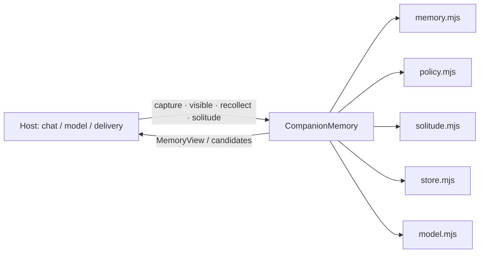

# AI Roleplay Recollection

> Chinese name: 朝花夕拾.

A dependency-free recollection engine for AI roleplay and companion characters: fading
recollections, unstructured solitude, and optional later contact.

[中文 README](README.md) · [Architecture](docs/architecture.md) · [API](docs/api.md)

## What it is

AI Roleplay Recollection treats **experiences**, not documents, as the unit of recollection:

- capture source-backed moments with `observed / reported / fictional` truth labels;
- let ordinary details fade from specifics to impressions, then out of daily recall;
- look up a few related memories for a normal reply **without an extra model call**;
- allow a private, unstructured moment where the character may wander, linger, or leave;
- keep any “I want to tell you something” as a candidate that the host must actually send
  and reconcile with a real receipt.

It is framework-agnostic. The host owns conversation, model access, timing, and delivery.

## What it is not

- Not a knowledge base, RAG index, reading app, or book-shelf;
- not a messaging bot: it never sends by itself;
- not a model provider: the host injects `reflect` / `wander`;
- not a full persona/relationship simulation;
- not a scheduler: the host decides when to call `solitude()`.

## Features

| Feature | Behavior |
| --- | --- |
| Source-backed episodes | 1–3 evidence excerpts, revision, withdrawal, source availability |
| Time-based fading | specific → impression → dormant; explicit retention excepted |
| Zero-extra-call lookup | `visible()` returns materials for an existing reply |
| Cue recall | optional one model call, with anchor/revision validation |
| Solitude | persisted 72–120 h opportunity; up to 2 steps; leave/linger/follow/switch |
| Later contact | intent only after solitude; 24 h expiry; receipt-based cooldown |
| Isolation | companion vs roleplay story, character and scope are separate |
| Persistence | atomic `memory-state.json`, `0600` file / `0700` directory, stale-lock recovery |

## Quick start

Requires Node.js ≥ 22. No runtime dependencies.

```bash
npm install roleplay-recollection
```

```js
import {CompanionMemory} from 'roleplay-recollection';

const memory = new CompanionMemory({
  characterId: 'xiaomiao',
  scopeId: 'private:owner',
  mode: 'companion',
}, {
  reflect: async () => ({value: {action: 'silence'}}),
  wander: async () => ({value: {action: 'leave'}}),
});

memory.capture({
  id: 'first-rain',
  truth: 'observed',
  occurredAt: Date.now() - 86400000,
  gist: 'The first time we listened to the rain together.',
  evidence: [{id: 'chat-1', kind: 'shared_event', text: 'It was raining outside.'}],
}, {mode: 'companion'});

console.log(memory.visible({mode: 'companion', trigger: 'cue', cue: 'rain'}));
await memory.close();
```

## DSH plugin

`dsh/` contains **`roleplay-recollection-dsh`**, a DSH Bundle that registers the core as Agent-callable `roleplay_recollection_*` tools (capture, visible lookup, cue recall, revise, withdraw, candidate management).

- Install, config, and tool list: [`dsh/README.md`](dsh/README.md)
- Publish `roleplay-recollection` first, then `roleplay-recollection-dsh`
- The bundle has no model adapter yet: `roleplay_recollection_visible` stays zero-model; `roleplay_recollection_recollect` returns a visible memory without producing thoughts or expressions

AstrBot is a Python plugin system and is not included in this package.

## Architecture



| Module | Responsibility |
| --- | --- |
| `src/core.mjs` | public entry and orchestration |
| `src/memory.mjs` | episode normalization, fading views, candidates, wander sampling |
| `src/policy.mjs` | config validation, situation rules, prompts, output validation |
| `src/solitude.mjs` | opportunity scheduling, wander loop, contact intents |
| `src/store.mjs` | state validation, writer lock, atomic writes |
| `src/model.mjs` | shared timeout/abort boundary for model hooks |

## Model call budget

| Path | Calls |
| --- | --- |
| `capture` / `revise` / `forget` / `pause` / `status` | 0 |
| `visible` / `privateThoughts` | 0 |
| `recollect({trigger:'cue'})` | 0 or 1 |
| `recollect({trigger:'idle'})` / `solitude()` | 0 to `maxWanderSteps` (2 by default) |
| `takeExpression` / `settleExpression` | 0 |

The daily budget is 2 by default and shared by cue recall and solitude; failed attempts count.

## Status

- **0.3.0 developer preview**; API may change before 1.0.
- **56 offline checks pass**: 35 core regressions + 19 solitude checks + 2 store-lock tests.
- Not yet verified: real-model naturalness, platform delivery (QQ/DSH), long-running
  stability.
- No network, no messages, no timers, no runtime dependencies.

## Documentation

- [Architecture](docs/architecture.md)
- [Solitude design](docs/solitude.md)
- [API reference](docs/api.md)
- [Verification](docs/verification.md)
- [Naming](docs/naming.md)
- [Releasing](docs/releasing.md)
- [Changelog](CHANGELOG.md)

## License

[MIT](LICENSE) © 2026 AI Roleplay Recollection contributors
