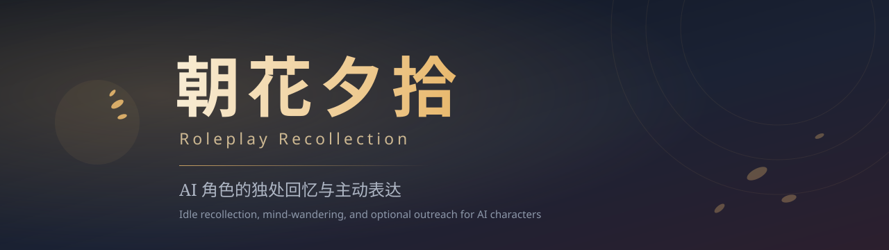

<p align="center">
  
</p>

# AI Roleplay Recollection · 朝花夕拾

面向角色扮演与对话伴侣的经历回忆模块。以离散事件为单位记录上下文，提供时间淡化、线索关联与受控的自主回想。

核心仅负责状态维护与候选生成；会话管理、模型调用与消息投递由宿主负责。

[English](README.en.md) · [API 参考](docs/api.md) · [架构设计](docs/architecture.md) · [DSH 插件](dsh/README.md) · [变更记录](CHANGELOG.md)

[](https://github.com/BCOIgv/roleplay-recollection/actions/workflows/ci.yml)
[](https://nodejs.org/)
[](LICENSE)

---

## 核心机制

- **基于凭据的经历记录**  
  记录单次相处片段（时间戳、概要、1–3 条原始引文、标签与真实度分类 `observed / reported / fictional`）。去重基于证据组哈希，支持版本修订与撤回。
- **渐进淡化**  
  未经明确保留的经历随时间降低精度：初期保留原句引文，后期退化为概括印象，最终退出日常召回。原始证据保留在本地状态中，但视图层不再向模型暴露细节。
- **零额外开销检索**  
  常规对话轮次调用 `visible()`，仅执行词面与标签过滤，不消耗模型配额。
- **长周期漫游（独处）**  
  在满足静默条件（默认 72–120 小时随机机会、连续无交互时段、活跃时间窗）时触发低步数漫游。允许静默离开；若产生表达意向，需由宿主取用并在获得实际投递回执后才结算冷却。

---

## 边界与分工

| 维度 | 约定 |
| --- | --- |
| **调度驱动** | 核心内无后台轮询守护，调用时机完全由宿主控制 |
| **模型接入** | 宿主注入 `reflect` / `wander` 执行器，核心不内置 SDK 与 API Key |
| **消息投递** | 核心仅产出候选（默认 `sent: false`），不负责外部平台发送 |
| **数据隔离** | 实例级隔离；角色、群组及剧情需分配独立的实例与持久化目录 |

---

## 安装与快速使用

环境要求：Node.js ≥ 22，纯 ESM，无运行时依赖。`0.3.0` 为开发预览版。

截至 2026-11-04，已发布 [GitHub Release v0.3.0](https://github.com/BCOIgv/roleplay-recollection/releases/tag/v0.3.0)，两个包尚未在公共 npm registry 提供。当前安装核心包：

```bash
npm install https://github.com/BCOIgv/roleplay-recollection/releases/download/v0.3.0/roleplay-recollection-0.3.0.tgz
```

```js
import { CompanionMemory } from 'roleplay-recollection';

const memory = new CompanionMemory({
  characterId: 'character_a',
  scopeId: 'private:user_01',
  mode: 'companion',
  stateDir: './data/memory_a', // 省略则仅驻留内存
});

// 记录一段经历
memory.capture({
  id: 'ev-20261104-01',
  truth: 'observed',
  occurredAt: Date.now() - 3600000,
  gist: '共同阅读文献并在雨声中交谈',
  tags: ['雨天', '阅读'],
  evidence: [{ id: 'msg-1', kind: 'shared_event', text: '窗外雨势渐大，提到正在翻看旧书。' }],
}, { mode: 'companion' });

// 常规对话检索（零额外模型开销）
const context = memory.visible({
  mode: 'companion',
  trigger: 'cue',
  cue: '旧书',
});

await memory.close();
```

---

## 行为

| 路径 | 行为 | 额外模型调用 |
| --- | --- | --- |
| `capture` / `revise` / `forget` | 记录、修订或撤回结构化经历 | 0 |
| `visible` / `privateThoughts` | 为已有回复提供可见记忆或暂定想法 | 0 |
| `recollect({trigger:'cue'})` | 线索匹配；可选生成想法或表达候选 | 0 或 1 |
| `solitude` / `recollect({trigger:'idle'})` | 到期且空闲时漫游记忆，可以直接离开 | 默认最多 2 |
| `takeExpression` / `settleExpression` | 取用候选；结算独处联系回执 | 0 |

---

## DSH 接入

`roleplay-recollection-dsh` 是单独的 Bundle，依赖核心包并注册 11 个 `roleplay_recollection_*` 工具。安装与配置见 [DSH 说明](https://github.com/BCOIgv/roleplay-recollection/tree/main/dsh#readme)。

当前 Bundle 不注入模型适配器，也不暴露 `solitude()`；线索回想只返回可见记忆。它不自动绑定调用者或聊天范围，不负责投递。生产接入需由宿主完成会话隔离及工具权限控制。

---

## 验证与限制

现有 56 项离线测试及三个示例通过，覆盖核心行为、独处和基础存储锁；这不代表真实模型、DSH 宿主、平台投递或并发稳定性已经验收。已知缺口及验证范围见 [验证说明](docs/verification.md)。

状态文件未加密。创建文件/目录时请求 POSIX `0600` / `0700`；已有目录权限及 Windows ACL 需由宿主配置，见 [安全说明](https://github.com/BCOIgv/roleplay-recollection/blob/main/SECURITY.md)。

---

## 文档与协议

- [API 参考](docs/api.md) · [架构设计](docs/architecture.md) · [独处设计](docs/solitude.md) · [发布清单](docs/releasing.md) · [贡献指南](CONTRIBUTING.md)
- 中文名「朝花夕拾」借用鲁迅散文集书名，借指对往事的淡化与回溯；对外统一标识为 `roleplay-recollection`。
- 许可证：[MIT](LICENSE) © 2026 AI Roleplay Recollection contributors
