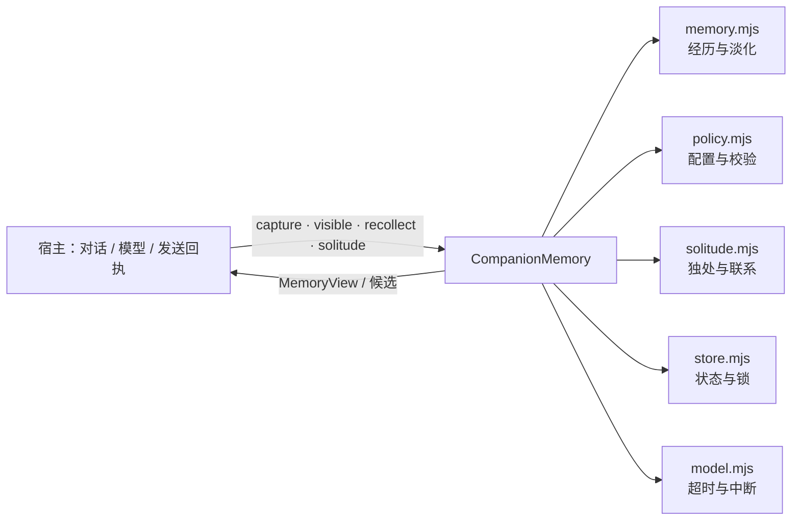

<p align="center">
  
</p>

<h1 align="center">AI Roleplay Recollection · 朝花夕拾</h1>

<p align="center">给 AI 角色扮演与陪伴角色的一层回忆：会想起，也会淡去；会独处，也可以不说。</p>

<p align="center">
  <a href="https://github.com/BCOIgv/roleplay-recollection/actions/workflows/ci.yml"></a>
  =22">
  
  
  
</p>

---

## 它是什么

一个纯 ESM、零运行时依赖的角色回忆核心。它把「经历」而不是「知识」作为单位：

- 记住有来源的小事，而不是建立文件索引或知识库；
- 让细节随时间变模糊，而不是永久保存原文；
- 在话题出现时取回少量相关记忆，不额外调用模型；
- 在独处时允许无目的地漫游，也可以什么都不说；
- 只有真实发送/回复回执才更新「联系过」的冷却。

它适合作为 AI 角色扮演、聊天机器人或陪伴应用里的**回忆层**，由宿主负责对话、模型、时机和投递。

## 它不是什么

| 不是 | 原因 |
| --- | --- |
| 通用知识库 / RAG 检索 | 不存文档、不建向量索引；只处理有来源的经历片段 |
| 阅读器 / 书架 / 书摘 | 旧原型方向已移除；阅读不是记忆的前提 |
| 自动发消息的机器人 | 只产生候选；发送与回执由宿主完成 |
| 模型供应商 SDK | 模型适配器由宿主注入，核心不持有 API Key |
| 完整人格模拟 | 不做好感度、情绪经济、人格成长或关系承诺 |
| 定时任务服务 | 不拥有定时器；宿主决定何时轮询/调用 |

## 特性

### 有来源的经历

`capture()` 接收结构化经历：时间、概括、1–3 条原始证据、标签、重要性、情绪权重，以及 `observed / reported / fictional` 三种真实性。同一来源不会因换 ID 重复入库；修订、撤回和来源失效都有明确路径。

### 会淡去

普通记忆按时间从「具体细节」退到「概括印象」，最终不参与日常候选。进入印象后，模型看不到原句和精确时间，也不能从旧私人想法里把细节「反推」出来。明确要求保留的记忆例外。

### 普通回复零额外调用

`visible()` 为本来就要发生的聊天回复提供少量材料，不新增模型请求；工作模式完全跳过记忆工作。

### 线索回想

`recollect({trigger:'cue'})` 按词面/标签关联取回少量候选，最多一次模型判断。输出可以是沉默、一条私人想法，或一个尚未发送的表达候选。

### 独处

`solitude()` 在随机 72–120 小时机会、安静时间窗和每日预算都满足时，允许角色无目的地翻看记忆：停留、顺着弱关联走、换念头或离开。没有任务、没有读者、没有消息配额；离开和零输出都是正常结果。

### 事后联系

只有独处结束后才可能产生「想分享」的意愿。意愿 24 小时有效，取出不等于已发送；只有 `sent` / `used_in_reply` 的真实回执才更新联系冷却，`unknown` 不重发并阻止新的主动投递。

## 快速开始

要求 Node.js ≥ 22，无运行时依赖：

```bash
npm install roleplay-recollection
```

```js
import {CompanionMemory} from 'roleplay-recollection';

const memory = new CompanionMemory({
  characterId: 'xiaomiao',
  scopeId: 'private:owner',
  mode: 'companion',
}, {
  // 宿主提供模型；核心不绑定供应商。
  reflect: async ({input}) => ({value: {action: 'silence'}}),
  wander: async ({input}) => ({value: {action: 'leave'}}),
});

memory.capture({
  id: 'first-rain',
  truth: 'observed',
  occurredAt: Date.now() - 86400000,
  gist: '第一次一起听雨',
  tags: ['雨', '安静'],
  importance: 0.6,
  emotionalWeight: 0.2,
  evidence: [{id: 'chat-1', kind: 'shared_event', text: '那天窗外下着雨。'}],
}, {mode: 'companion'});

const materials = memory.visible({
  mode: 'companion',
  trigger: 'cue',
  cue: '下雨',
});
```

完整方法、参数和返回形状见 [API 参考](docs/api.md)；可运行示例见 [`examples/`](examples/)。

## DSH 插件

`dsh/` 提供 **`roleplay-recollection-dsh`** DSH Bundle：它把核心注册为 Agent 可调用的 `roleplay_recollection_*` 工具（捕获、可见查询、线索回想、修订、撤回、候选管理等），由 DSH 插件管理器安装。

- 安装、配置和工具列表见 [`dsh/README.md`](dsh/README.md)
- 发布顺序：先发 `roleplay-recollection`，再发 `roleplay-recollection-dsh`
- 当前 Bundle 不带模型适配器：`roleplay_recollection_visible` 仍是零模型查询；`roleplay_recollection_recollect` 在没有模型适配时只返回可见记忆，不产生想法或表达

AstrBot 是 Python 插件体系，本包暂不包含 AstrBot 适配。

## 架构



| 模块 | 一句话 |
| --- | --- |
| `src/core.mjs` | 公共入口与编排 |
| `src/memory.mjs` | 经历标准化、淡化视图、候选与漫游采样 |
| `src/policy.mjs` | 配置范围、情境判断、提示词、输出校验 |
| `src/solitude.mjs` | 独处机会、漫游循环、联系意愿与回执 |
| `src/store.mjs` | 状态校验、文件锁、原子写入 |
| `src/model.mjs` | 统一的模型调用超时/取消边界 |

详细设计见 [架构](docs/architecture.md) 与 [独处设计](docs/solitude.md)。

## 模型调用预算

| 路径 | 调用 |
| --- | --- |
| `capture` / `revise` / `forget` / `pause` / `status` | 0 |
| `visible` / `privateThoughts` | 0 |
| `recollect({trigger:'cue'})` | 0 或 1 |
| `recollect({trigger:'idle'})` / `solitude()` | 0 到 `maxWanderSteps`（默认最多 2） |
| `takeExpression` / `settleExpression` | 0 |

每日预算默认 2 次，线索回想与独处共享；失败/超时尝试也计数。

## API 一览

| 方法 | 作用 |
| --- | --- |
| `status()` | 只读快照：经历、预算、下次独处、待处理意愿 |
| `capture(raw, context)` | 写入一段有来源的经历 |
| `revise(id, revision, raw)` | 修订经历并清除衍生内容 |
| `forget(id)` | 撤回经历 |
| `setSourceAvailable(id, available)` | 标记来源是否仍可访问 |
| `pause(value)` | 暂停/恢复可选记忆工作 |
| `visible(context)` | 普通回复用的零模型查询 |
| `privateThoughts(context)` | 取回仍可见的私人想法 |
| `recollect(context, {signal})` | 一次线索回想；`idle` 转入独处 |
| `solitude(context, {signal})` | 一次独处机会 |
| `takeExpression(id, context)` | 取出表达候选（仍未发送） |
| `settleExpression(id, {outcome, receipt})` | 用真实回执结算联系 |
| `close()` | 中止并关闭 |

## 状态与限制

- **0.3.0（developer preview）**：API 在 1.0 前可能小幅调整。
- **56 项离线检查通过**：35 项核心回归 + 19 项独处 + 2 项存储锁。
- **未验收**：真实模型自然度、QQ/DSH 等平台端到端投递、长时间运行稳定性。
- **无运行时依赖**；不访问网络；不发送消息；不启动定时器。
- 状态文件写入本地 `memory-state.json`，权限 `0600`，目录 `0700`。

## 文档

- [架构](docs/architecture.md)
- [独处设计](docs/solitude.md)
- [API 参考](docs/api.md)
- [验证说明](docs/verification.md)
- [命名评估](docs/naming.md)
- [发布清单](docs/releasing.md)
- [变更记录](CHANGELOG.md)

## 开发

```bash
npm test            # 56 项测试
npm run check       # 语法与包元数据
npm run verify      # 语法 + 测试 + 三个示例
npm run demo:basic  # 最小可见查询
npm run demo        # 陪伴场景
npm run demo:solitude
```

贡献方式见 [CONTRIBUTING.md](CONTRIBUTING.md)；安全问题见 [SECURITY.md](SECURITY.md)。

## 名字

「朝花夕拾」是中文名，直接借用鲁迅散文集的书名，不再另造词或加副句；GitHub 与 npm 使用直白名 `roleplay-recollection`，检索入口不依赖中文名。完整评估与候选对比见 [命名评估](docs/naming.md)。

## 许可证

[MIT](LICENSE) © 2026 AI Roleplay Recollection contributors
