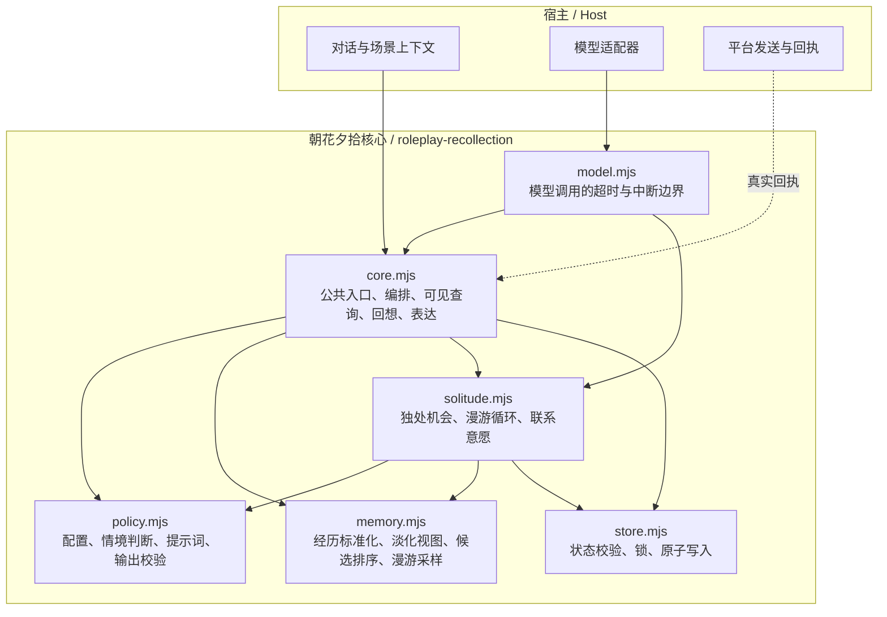
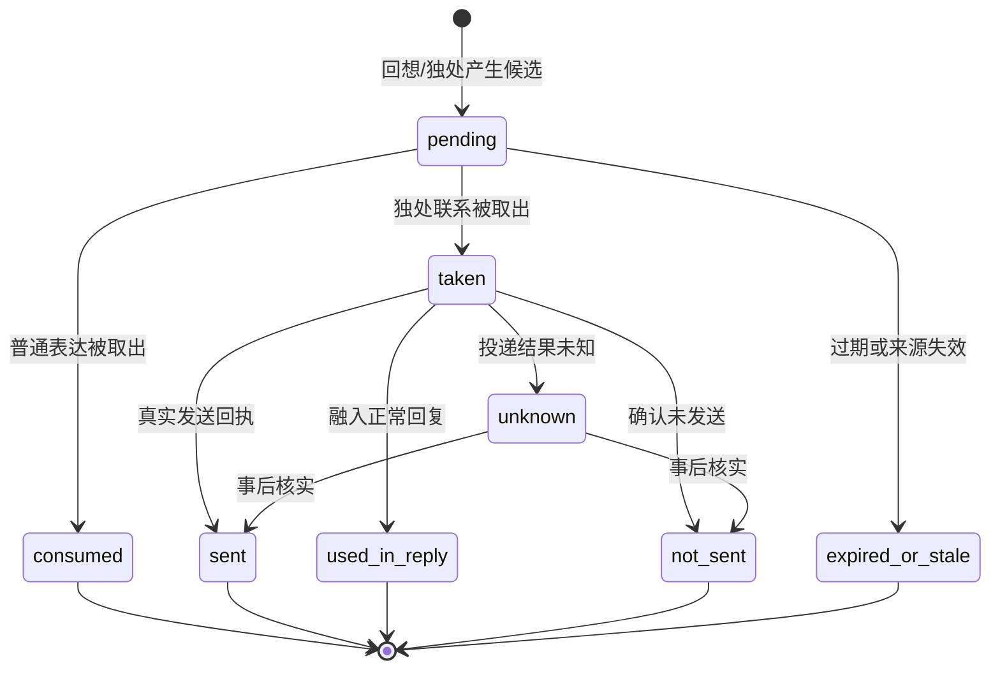
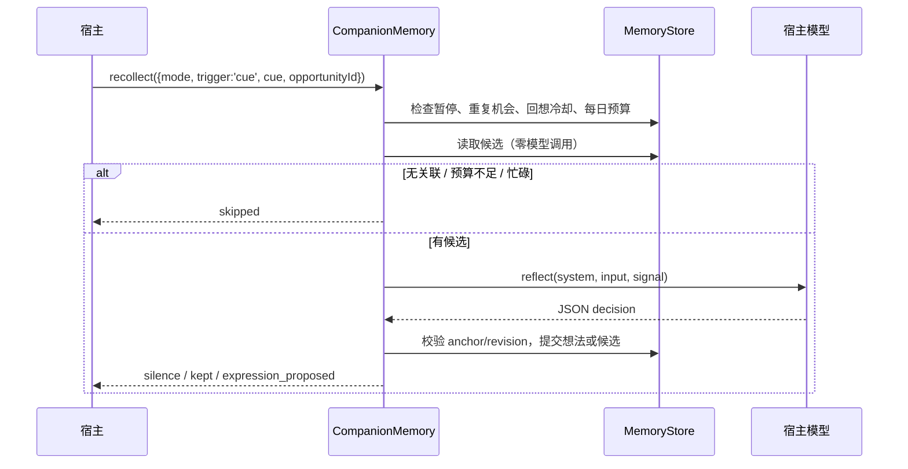
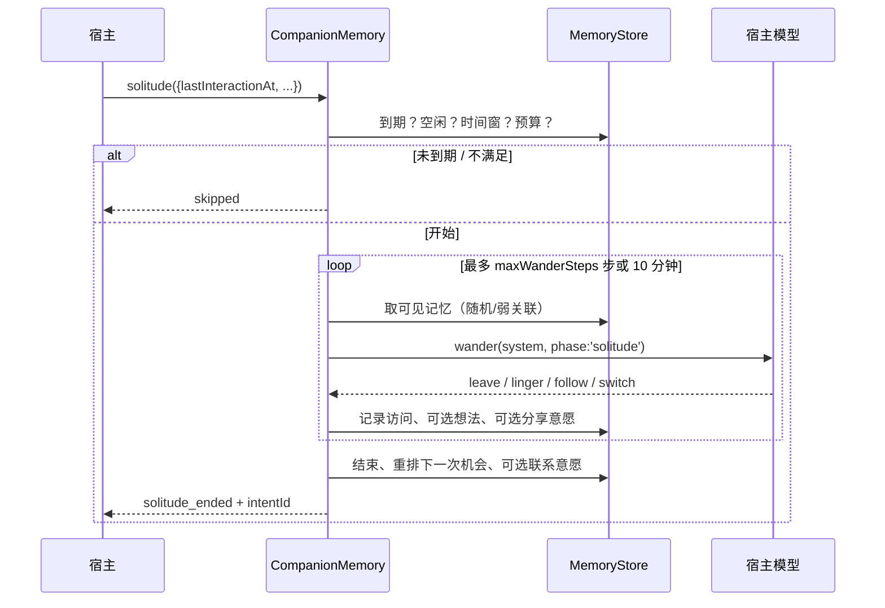

> 本文描述公开 0.3.0 的局部核心基线。当前源码新增的全局架构、修复和边界见 [全局 RP 接入说明](read-only-sources.md)。

# 架构

> 适用版本：roleplay-recollection 0.3.0。已知实现缺口见 [验证说明](verification.md)。

## 1. 定位

`roleplay-recollection`（英文名 Roleplay Recollection，中文品牌朝花夕拾）定位为已有记忆之上的 AI 角色回忆行为层，功能副标题为“AI 角色的独处回忆与主动表达”。本页的历史局部核心以结构化经历为输入，提供细节淡化、线索匹配与低频漫游；当前全局来源接入见页首链接。

当前边界与候选优化见[漫游边界研究](wandering-boundaries.md)，产品价值验证见[分阶段测试计划](evaluation-plan.md)。这些提案尚未改变运行参数或成为已验收能力。

核心只负责状态存储与候选生成，不包含会话调度、模型接口与消息投递。宿主系统的职责：

1. 把真实对话映射为 `characterId / scopeId / mode / storyId`；
2. 决定何时调用 `visible()`、`recollect()` 或 `solitude()`；
3. 提供模型适配器（`reflect` / `wander`）；
4. 真正发送消息，并把回执交回 `settleExpression()`。

系统边界：**核心仅生成记忆视图与表达候选，不直接生成客观事实、不做出行为承诺，也不主动向外部平台发信。**

## 2. 设计原则

- **事件驱动而非全量索引**：以具备来源凭据的经历片段为最小单位，不构建通用向量知识库或长文档索引。
- **候选解耦**：模型思考、内部暂存想法与对外表达候选彼此分离，静默或无候选均为有效结果。
- **渐进降级**：非明确保留条目按半衰期由详细原句降级为模糊印象，再逐步退出召回。
- **常规检索零额外模型调用**：常规对话上下文检索（`visible`）仅执行本地筛选；回复模型与宿主仍有各自成本。
- **作用域硬隔离**：陪伴模式与剧情模式在数据模型上完全隔离，实例级绑定。
- **状态回执闭环**：候选提取与真实投递分离，需宿主提交实际发送回执后方可完成状态结算与冷却重置。
- **可审计性**：所有记忆变动、检索过程、漫游记录与投递状态均可追溯。

## 3. 分层结构



### 模块职责

| 模块 | 职责 | 不负责 |
| --- | --- | --- |
| `src/core.mjs` | 对外类 `CompanionMemory`；捕获、修订、撤回、可见查询、回想、表达、关闭 | 平台发送、定时器、模型供应商 |
| `src/memory.mjs` | 经历标准化与去重；时间淡化；候选评分；独处漫游的加权采样 | 状态持久化、提示词 |
| `src/policy.mjs` | 默认配置与范围校验；情境判断；提示词；模型输出校验 | 业务编排 |
| `src/solitude.mjs` | 下一次独处机会的调度；独处循环；联系意愿与回执 | 真实消息投递 |
| `src/store.mjs` | 状态版本校验；文件锁；临时文件 + rename 原子写入 | 业务规则 |
| `src/model.mjs` | 统一 `AbortSignal`、超时、取消原因 | 具体模型调用 |

## 4. 数据模型

### 经历（Episode）

```text
id, revision, sourceKey, truth, storyId, occurredAt, gist, evidence[], tags[],
importance, emotionalWeight, retention,
status(active|unavailable|withdrawn),
capturedAt, lastRecalledAt, lastExpressionAt, lastWanderSeenAt, lastContactAt,
recallCount, rehearsalBoost, detailFaded
```

- `truth`：`observed`（记录的事件）、`reported`（用户陈述，不等于独立验证）、`fictional`（仅存在于故事内）。
- `sourceKey`：由整组证据的 kind/id/text 排序后哈希；仅完整组相同才判重复，重叠证据或修改摘录尚不能识别。
- `revision`：由经历内容哈希，修订必须带当前 revision。
- `importance` / `emotionalWeight`：由调用方提供，不从模型自述推断真实情绪。

### 记忆视图（MemoryView）

`memoryView()` 是投影，不是另一份存储：

```text
activation = retained ? initial : min(initial, base + reinforcement)

initial      = 0.45 + 0.4 * importance + 0.15 * emotionalWeight
halfLifeDays = 7 + 21 * importance + 14 * emotionalWeight
base         = initial * 0.5 ^ (ageDays / halfLifeDays)
reinforcement= rehearsalBoost * 0.5 ^ (daysSinceRecall / halfLifeDays)
```

- `activation < dormantThreshold`：不参与日常候选。
- `detail` 为 `impression` 时：不返回原句证据和精确时间。原始证据仍保存在状态中；gist/tags 由调用方提供，不会自动删除其中的精确信息。
- `detailFaded` 一旦为真，不会因为再次回想而恢复原句。
- 参数是行为设置，不宣称是人脑模型或经过校准的心理概率。

### 想法与表达

- **私人想法**：绑定一条可见经历，标记 `tentative_reflection`；不能回流为经历、事实或自证材料。
- **表达候选**：绑定经历 revision 与当前 detail；只是「可以说什么」，`sent: false`，有 24 小时有效期。
- **联系意愿**：独处结束后才可能产生；取出候选不等于已发送，必须用真实回执结算。

### 状态机：表达与联系



## 5. 主流程

### 5.1 捕获与可见查询

1. 宿主提供结构化经历与当前场景。
2. `capture()` 校验模式、故事、时间、证据类型、显著性、容量与去重。
3. 内容进入 `episodes`，状态 `active`。
4. 普通回复需要材料时调用 `visible()`：按线索/标签/显著性排序，**不新增模型调用**。
5. 工作模式直接返回空数组，完全跳过。

### 5.2 线索回想



关键约束：

- cue 路径的 `opportunityId` 由宿主提供；在最近保留的运行记录内去重。
- 回想冷却默认 6 小时；每日模型预算默认 2 次，与独处共享。
- `anchor` 必须是当前可见文本的精确子串；模型不能引用未见过的记忆。
- 来源在生成过程中被修订/撤回/设为不可用时，晚到的结果会被拒绝。

### 5.3 独处与事后联系



独处的详细参数、机会调度和联系冷却见 [独处设计](solitude.md)。

## 6. 模型调用预算

| 路径 | 模型调用 | 说明 |
| --- | --- | --- |
| `capture` / `revise` / `forget` / `setSourceAvailable` / `pause` | 0 | 纯状态操作 |
| `visible` / `privateThoughts` / `status` | 0 | 只读投影 |
| `recollect({trigger:'cue'})` | 0 或 1 | 有候选且配置了 `reflect` 时才调用 |
| `recollect({trigger:'idle'})` / `solitude()` | 0 到 `maxWanderSteps` | 默认最多 2 步；每步调用前计数 |
| `takeExpression` / `settleExpression` | 0 | 只做检查与回执 |

- 每日预算按固定上海日切分（UTC+8），默认 2 次。
- 线索回想与独处共享同一预算。
- 模型失败/超时的尝试仍计入预算，避免故障时无限重试。
- 独处不会额外获得独立额度。

## 7. 中断、失败与并发

- **前台优先**：宿主需传递 `AbortSignal` 或调用相应控制入口；核心不会自行监听用户消息。cue 路径当前未检查 `hasPendingWork`，详见验证说明。
- **晚到结果拒绝**：每次运行有 `token`（id + epoch + pid）；暂停、修订、撤回或新一轮运行会改变 epoch，旧结果不能提交。
- **不补跑**：中断的独处结束并重排下一次机会，不会恢复成积压任务。
- **超时**：单次模型调用默认 30 秒；超时按失败记录，不自动重试。
- **投递未知**：记录存在时 `unknown` 阻止新的主动投递；当前来源变更会删除未决记录，宿主需保留独立投递账本。
- **文件锁**：使用 `wx` 创建并记录 PID；初始化和回收存在竞争窗口，目前不保证多进程写入安全。
- **写入**：先写临时文件，再 `rename` 覆盖。创建时请求 POSIX `0600` / `0700`；已有目录权限及 Windows ACL 由宿主设置。模型调用使用临时超时计时器，核心没有后台调度器。

## 8. 持久化

- 默认无 `stateDir` 时只保存在内存中；传入 `stateDir` 后写入 `memory-state.json`。
- 状态版本 `2`，兼容 0.2.0 的经历、想法和调用计数；首次加入独处计划。
- 写入上限 2.5 MiB；经历上限默认 200 条（含撤回墓碑），想法上限默认 100 条。
- 状态目录必须是真实目录，不接受指向别处的符号链接/目录联接。
- 每个身份使用独立目录；当前应限制为单写入进程。

## 9. 边界与非目标

当前版本**不做**：

- 后台调度器、后台服务、系统唤醒；
- QQ / AstrBot / 微信等平台适配；
- 模型供应商接入、API Key 管理；
- 自动发送、已读回执伪造；
- 情绪测量、人格成长、好感度数值、完整模拟人生；
- 文件扫描、书架、阅读进度、知识库。

这些属于宿主或后续版本。核心保持小而可测，先验证行为，再谈适配。

## 10. 验证

- 56 项离线测试：54 项既有行为回归 + 2 项存储锁回归。
- 3 个示例：基础可见查询、陪伴场景、独处场景。
- 全部离线，不调用外部模型、不发送消息。
- 真实模型自然度、平台端到端投递、长时间运行稳定性**尚未验收**。

复现命令见 [验证说明](verification.md)。

## 11. DSH 适配

`dsh/` 是一个薄适配层，不是第二套核心：

- `roleplay-recollection-dsh` 是 DSH Bundle，`dsh.bundle.patch` 插入一行 Host 插件；
- `index.js` 把核心注册为 `roleplay_recollection_*` 工具，负责参数/返回值适配；
- 所有记忆规则仍由 `roleplay-recollection` 执行，状态仍写入同一个 `memory-state.json`；
- 当前 DSH Bundle 不带模型适配器：`roleplay_recollection_visible` 是零模型查询，`roleplay_recollection_recollect` 只返回可见记忆，不产生想法或表达；
- AstrBot 是 Python 插件体系，不在本包范围内。
