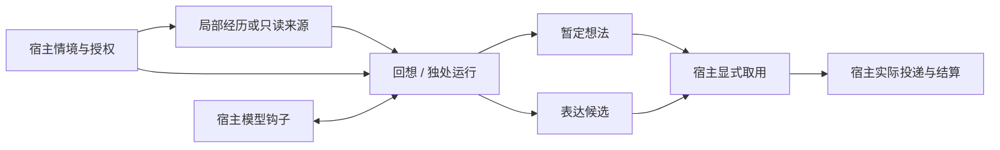

# 当前源码架构

朝花夕拾是已有记忆之上的角色回忆行为层。宿主传入经历、当前情境和模型钩子；核心管理可见材料、运行机会、预算、暂定想法及表达候选。源码模块没有平台调度器、模型供应商客户端或消息发送器。

## 模块与数据流

| 位置 | 已实现职责 |
| --- | --- |
| `src/core.mjs` / `src/memory.mjs` | 局部结构化经历、稳定来源去重、修订/撤回、淡化投影、线索排序 |
| `src/solitude.mjs` | 局部独处计划、随机/弱关联选材、步进、联系取用与回执 |
| `src/sources.mjs` / `src/source-sqlite.mjs` | 有界只读来源快照、字段映射、授权与分页 |
| `src/source-setup.mjs` | 来源探测、确定性或模型辅助映射，写入独立配置目录 |
| `src/global-core.mjs` | 跨来源查询、受众绑定、来源复核、全局回想与独处 |
| `src/policy.mjs` / `src/model.mjs` | 配置校验、提示词、输出契约、模型调用的超时/取消 |
| `src/store.mjs` / `src/fs-retry.mjs` | 状态、写锁 guard、文件替换及有限 Windows 文件操作重试 |
| `dsh/` | 局部 11 个工具或全局 9 个工具；宿主提供权限与模型服务 |
| `evaluation/` | 脚本化探针、合成模型试跑、实验宿主与汇总工具；不属于生产核心 |

## 两条运行路径

| 行为 | CompanionMemory | GlobalRecollection |
| --- | --- | --- |
| 输入 | 单一身份范围的结构化经历 | 宿主授权的多来源材料，保留原 scope/truth/story |
| 线索选择 | 词面、标签、可见激活度排序 | 文字包含过滤，按候选上限返回 |
| `follow` | 以词面/标签重叠辅助下一步选择 | 从剩余材料继续取样，没有局部的关联加权 |
| `linger` | 复看当前焦点 | 把焦点放在列表首位，可附带其他材料 |
| 暂定想法 | 校验 revision/detail 后返回最近最多 3 条 | 按授权和来源投影复核后返回最近最多 3 条文本 |
| 结束记录 | 有 step_limit、model_budget 等原因 | 部分正常结束只给 solitude_ended，无详细原因 |
| 前台到来 | 新一次 busy 调用可中断本实例独处 | 新 busy 调用仅跳过，须取消原调用或调用 pause/close |

两条路径都不会自动把想法传入下一次漫游或普通回复。实验时间线宿主另有选材、提示和想法台账，详见[评估工具](../evaluation/README.md)；其结果不能直接归为默认核心行为。

## 状态与来源

局部经历使用 `sourceKey`（整组证据哈希）及新记录的 `sourceIds`（证据 kind/id 哈希）。捕获会拒绝任一来源身份重叠；旧记录缺少 sourceIds 时不能追溯补出这些身份。修订时的其他经历冲突检查仍使用 sourceKey。

普通经历按激活度从细节变为印象或退出召回。淡化隐藏原句和精确时间，不会删除状态里的原文，也不会重写宿主提供的 gist/tags。原生外部来源沿用此投影；通用来源的可见 detail 由映射和宿主策略提供。

想法是暂定内容，不是新的事实证据。精确 anchor 只能验证引用子串存在，不能验证整段模型输出的事实、时间或因果关系。语义错误仍需评估。

## 候选与投递

局部线索表达取用后变为 consumed；局部独处联系及全局表达通过 pending → taken → sent / used_in_reply / not_sent / unknown 结算。unknown 不自动重发。来源改变后，已 taken/unknown 的记录擦除正文、保留结算字段，支持晚到回执。

构造与运行状态保存在独立 stateDir；省略时只在内存。持久状态格式为 2。写锁 guard 串行化建立/回收，未知锁保守拒绝；崩溃留下 guard 时需要人工检查。状态文件未加密，目录权限由宿主配置。

## 资源与验证

默认单次独处最多 2 步，与线索回想共享每日 2 次模型调用预算；单步传给钩子的输出请求为 500 tokens，超时 30 秒，整次时限 10 分钟。失败尝试也计入预算；核心不自动重试模型请求。完整数值和范围见 [API](api.md#行为参数)。

可复现检查、合成试跑及其限制见[验证说明](verification.md)。统一结束语义、动态预算和短会话状态属于[候选研究](wandering-boundaries.md)，不构成现有功能。
